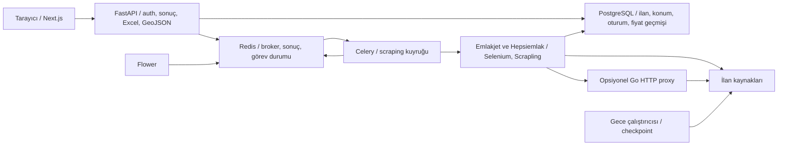

# Real Estate Scraper performans denetimi

23 Kasım 2026 · `main` · `fe6bdf8` ve checkout’taki görev durumu ile frontend değişiklikleri.

## Karar

Mevcut yığını koru. İlk iş, FastAPI event loop üzerindeki senkron SQL, Redis ve CPU işlerini taşı. İkinci iş, sonuç ekranında birden fazla uç noktanın aynı ilan verisini yeniden gruplamasını azalt. Üçüncü iş, ilçe geometrilerini küçült ve masaüstü WebGL’in aktarım ve çalışma maliyetini düşür. Worker kapasitesini kuyruk bekleme süresi, iş başına kaynak kullanımı ve kayıt doğruluğu ölçüldükten sonra ayarla.

En net kanıt, 100 bin sentetik ilanlı ASGI testinde `/analytics/stats` isteğinin event loop zamanlayıcısını medyanda **574 ms** geciktirmesi. Ayrı SQL testinde 20 grup döndüren sonuç sayfası filtrelenmemiş veriyle **671 ms** sürdü. Her iki sonuç Windows üzerinde bellek içi SQLite ölçümü. Üretim PostgreSQL planları ve servis p95 değerleri henüz bilinmiyor.

## Mimari ve kapsam

| Bileşen | İncelenen çalışma biçimi | Ölçüm |
| --- | --- | --- |
| Next.js 16.4.1, React 19.2.1, TanStack Query | Dashboard, tablo, grafik, auth, görev takibi ve harita. Compose Node 22 dev sunucusu, ayrı Dockerfile standalone üretim çıktısı | Beş Playwright senaryosu, 19 birim testi, iki üretim derleme denemesi |
| FastAPI, SQLAlchemy, psycopg2 | Cookie auth, senkron SQL oturumu, cache ve export. API imajı Python 3.13 ve tek Uvicorn süreci | ASGI zamanlayıcı testi, Excel üretimi, çevrimdışı Python testleri |
| PostgreSQL 16 | İlan ve konum filtreleri, sıralama, gruplama, fiyat dağılımı, toplu yazma ve geçmiş | Bellek içi SQLite karşılığı. PostgreSQL planları bekliyor |
| Redis 7.4, Celery 5.6, Flower | Aynı Redis URL üzerinden broker, Celery backend ve uygulama durumu. Tek `scraping` kuyruğu ve tek yürütme slotu | FakeRedis sözleşme testleri ve kaynak incelemesi |
| Python 3.11 worker, Chrome, Playwright Chromium | Selenium ve Scrapling oturumları/Spider, ilan sayfasını ayrıştırma, DB yazımı, log ve iptal | Parser ve yazma testleri. İş başı CPU/RSS ve uçtan uca hız bekliyor |
| Go HTTP proxy | Python istemcisi, bağlantı havuzu, HTTP aktarımı ve JSON yanıtı. `go.mod` 1.26, imaj 1.27 | `go test -count=1 -short ./...`. Canlı ağ testi hariç |
| Compose, imajlar, gece çalıştırıcısı | Altı uygulama/veri servisi ve Flower, dev bind mount’ları, healthcheck, yerel checkpoint ve çıktı | Compose yapılandırma kontrolü, kod incelemesi. Container çalıştırma ve kaynak ölçümü bekliyor |

Akışın giriş noktaları [Frontend/app/layout.tsx](../Frontend/app/layout.tsx), [Backend/main.py](../Backend/main.py), [Backend/celery_app.py](../Backend/celery_app.py), [Backend/go/main.go](../Backend/go/main.go), [docker-compose.yml](../docker-compose.yml) ve [run_overnight_scraper.py](../run_overnight_scraper.py). Graphify ve GitNexus, commit `fe6bdf8` üzerindeki akışları gösterdi. Commit edilmemiş satırlar kaynak dosyalardan doğrulandı.

## Önceliklendirilmiş bulgular

| Öncelik | Alan | Kanıt | Yapılacak iş |
| --- | --- | --- | --- |
| P1 | API eşzamanlılığı | ASGI testinde tek ağır istek event loop’u yüzlerce ms geciktirdi | Senkron I/O kullanan handler ve bağımlılıkları thread pool yoluna taşı. Auth, görev durumu ve analitikle başla |
| P1 | Sonuç sorguları | 100 bin ilanla sayfa 671 ms, filtre seçenekleri 1.361 ms ve genel görünüm 1.426 ms yerel medyan | Gerçek PostgreSQL planlarını al. Filtre ve özet sorgularını daralt. Tazelik politikası ile tekrarları kes |
| P1 | GeoJSON | İlçe dosyaları toplam 79,5 MB. İstanbul sıkıştırılmış simülasyonda bile 1,75 MB | Geometriyi ölçeğe göre sadeleştir, sürümlü sıkıştırılmış servis ve çizim cache’i dene |
| P1 | Dağıtım | Compose frontend açılışında `npm install && npm run dev` | Performans ölçümünü ve dağıtımı standalone imaj üzerinde yap. Windows yerel paketlemeyi ayrı doğrula |
| P2 | Redis ve polling | Dashboard’da 3/15 sn aktif liste, takipte 2 sn detay. Redis snapshot’ları log dizisini tekrar taşıyor | Tek uçuşlu polling, boşta geri çekilme, küçük liste yanıtı, birleştirilmiş ilerleme yazımı |
| P2 | Celery ve scraper | Tek slot, 7.200 sn hard limit, sayfa commit’leri ve tam tarama listesi | Kuyruk yaşını ve aşama sürelerini ölç. Sayfa bazlı dayanıklılığı ve iptali koruyarak bellek ile commit sayısını düşür |
| P2 | JavaScript ve GPU | Masaüstü dashboard 353 kB aktarım, azaltılmış hareket 238 kB | Ortak client girişini ve WebGL parçasını profille. Pahalı bileşenleri görünür ve gerekli olduğunda yükle |
| P2 | Excel ve Go proxy | 10 bin satırlı XLSX üretimi 5,49 sn. Proxy tam gövde ve Base64 JSON oluşturuyor | Export bekleme/RSS ve proxy aktarım boyutu için bütçe belirle, ölçüme göre optimize et |

### API, kimlik doğrulama ve okuma modeli

1. **Tek API event loop, senkron bloklar.** `def` olarak tanımlanan `/results` ve yeni fiyat özeti thread pool kullanır. Router genelindeki `get_current_user` ise `async def` içinde senkron kullanıcı sorgusu çalıştırır. Aynı örüntü `/stats`, ilan listesi, görev uçları, kuyruk gönderimi, ilçe dosyalarının ilk okunması ve login/register içindeki SQL ile parola işlemlerinde var. Önce senkron bağımlılıkları uygun yürütme yoluna taşı. Thread talebi ile DB havuz beklemesini birlikte izle. PostgreSQL havuzu süreç başına 10 sürekli ve 20 taşma bağlantısı kabul eder. Worker/API süreç sayısı artırılırsa bu bütçeyi toplam DB kapasitesine göre yeniden hesapla. [auth/dependencies.py:14](../Backend/auth/dependencies.py#L14), [auth/router.py:108](../Backend/auth/router.py#L108), [api/endpoints.py:210](../Backend/api/endpoints.py#L210), [connection.py:18](../Backend/database/connection.py#L18), [FastAPI concurrency](https://fastapi.tiangolo.com/async/).

2. **Sayfalama ağ yükünü sınırlar, gruplama maliyeti kalır.** `/results` JOIN, altı kolonlu GROUP BY, tarih sıralaması ve toplam grup için `COUNT(*) OVER()` kullanır. Boş derin sayfa önce boş sorgu, ardından toplam ve geçerli son sayfa sorgusunu çalıştırır. `/results/filters` ve `/results/overview` grupları tekrar üretir ve Python’da dolaşır. `/stats` tek çağrıda altı SQL çalıştırır. İlk adaylar filtre seçenekleri için daha dar projeksiyon ve sonuç ekranındaki kapsayıcı özet sorgular için kısa, filtreye göre anahtarlanmış cache. Ekranın kabul edebileceği veri tazeliğini belirle ve scrape/silme yollarıyla invalidasyonu doğrula. `COUNT` ve `OFFSET` maliyeti planlarda doğrulanırsa toplamı ayrı hesaplama, cursor veya grup özet tablosu değerlendirilebilir. [results.py:102](../Backend/database/results.py#L102), [results.py:146](../Backend/database/results.py#L146), [results.py:174](../Backend/database/results.py#L174), [results.py:201](../Backend/database/results.py#L201), [crud.py:850](../Backend/database/crud.py#L850), [PostgreSQL EXPLAIN](https://www.postgresql.org/docs/16/using-explain.html).

3. **Fiyat özeti ve şehir detayının maliyeti farklı.** `/analytics/prices` veriyi özetlemek için SQL kullanıyor. Veri ve benzersiz histogram kenarları varsa beş SQL çalışıyor. Şehir ve ilçe filtresi birlikte iki DISTINCT araması ekleyebiliyor. Medyan/çeyreklik sunan `/analytics/stats` bütün fiyatları belleğe alıyor. Haritadan erişilen şehir detayı bütün konumları ORM ile yükleyip eşleşen ilan nesnelerini de materialize ediyor. Şehir adına indekslenebilir normalize edilmiş anahtar veya önce dar bir aday sorgusu ekle. Mevcut ortalama, dilim, Türkçe ad eşleştirmesi ve fiyat geçmişi çıktıları karşılaştırılmadan eski uçları birleştirme. [results.py:75](../Backend/database/results.py#L75), [results.py:228](../Backend/database/results.py#L228), [api/endpoints.py:304](../Backend/api/endpoints.py#L304), [crud.py:692](../Backend/database/crud.py#L692), [ResultsMapInner.tsx:127](../Frontend/components/ui/ResultsMapInner.tsx#L127).

4. **İndeksleri gerçek planla seç.** Şema URL benzersizliği, konum FK, fiyat, tarih ve platform/kategori/ilan tipi/konum birleşik indekslerini tanımlıyor. Özel alt kategori, tarih sıralaması ve toplama ihtiyacı erişim örüntüsüne göre değişir. Temsili veriyle en pahalı uçlarda `EXPLAIN (ANALYZE, BUFFERS)` al. Mevcut indeksleri `pg_stat_user_indexes`, sorgu dağılımını kuruluysa `pg_stat_statements` ile değerlendir. Yeni indeks için önce kazanılan okuma maliyeti ile yazma maliyetini ölç. Ayrıca `/listings` ve önizlemede handler seviyesinde `page/limit` sınırları ekle. Her API açılışında tüm scrape oturumlarının ORM ile yüklenip durum normalize edilmesini, uygun bir defalık veri migration’ına taşı. [models.py:74](../Backend/database/models.py#L74), [crud.py:511](../Backend/database/crud.py#L511), [crud.py:648](../Backend/database/crud.py#L648), [api/endpoints.py:512](../Backend/api/endpoints.py#L512), [main.py:51](../Backend/main.py#L51).

5. **Excel CPU izolasyonu mevcut, bekleme ve bellek kaldı.** 10 bin satır sınırı ve API süreci başına tek export kilidi var. SQL hazırlığı thread pool’a, workbook ayrı işleme gidiyor. Ancak ORM sonuçları, satır sözlükleri, DataFrame, workbook ve sonuç baytları farklı aşamalarda bellekte oluşturuluyor. Ortak ilan sorgusu ayrıca export’un kullanmadığı `COUNT` hesaplıyor. İlk iyileştirme sayım gerektirmeyen seçili sütun sorgusu. Ardından sorgu, kuyruk, XLSX üretimi, dosya boyutu ve tepe bellek ayrı ölçülsün. Kullanıcı deneyimi hâlâ yetersizse ayrı export kuyruğunu değerlendir. [api/endpoints.py:632](../Backend/api/endpoints.py#L632), [api/endpoints.py:683](../Backend/api/endpoints.py#L683), [crud.py:548](../Backend/database/crud.py#L548).

### Celery, Redis, scraper ve proxy

6. **Uzun işler kısa işleri kuyrukta bekletiyor.** Worker komutu ve Celery config eşzamanlılığı 1 olarak ayarlıyor. `prefetch=1`, geç ack ve 6.900/7.200 sn zaman sınırları mevcut. Bir iş bitmeden diğer iş aynı slotta başlayamaz. Kuyruk yaşı ve 1 şehir/çok şehir işlerinin süre dağılımı ilk ölçüm. Kısa/uzun iş rotalaması veya checkpoint’li parçalara bölme deneyinden önce fiyat geçmişi, iptal ve yeniden teslim davranışını fixture ile doğrula. Birden fazla worker açmak, aggregate tarayıcı/RSS/DB maliyetini de artırır. `apply_async` görev snapshot’ından önce çalıştığı için hızlı bir worker ile başlangıç yarışı riski sürüyor. [celery_app.py:17](../Backend/celery_app.py#L17), [Dockerfile.worker](../Backend/Dockerfile.worker), [api/endpoints.py:84](../Backend/api/endpoints.py#L84), [Celery optimizasyon kılavuzu](https://docs.celeryq.dev/en/stable/userguide/optimizing.html).

7. **Redis iş yükü iki yönde büyüyor.** Checkout, aktif iş listesini `SMEMBERS` ve `MGET` ile topluyor. İlk istekte hazır işareti eksikse eski görevler için `SCAN` ve tekil `GET` çalışıyor. Aktif liste ve detay aynı loglu payload’ı taşıyor. Bir log veya ilerleme olayı, snapshot oku/yaz ve Celery progress backend’ine ek yazımla sonuçlanabiliyor. `TaskStatusStore` oluşturulduğunda Redis istemcisi/pool’u da yeniden kuruluyor. Süreç içi istemciyi paylaşmayı, ilk indeks hazırlığını istek yolundan çıkarmayı ve en fazla 40 olaylık log dizisini detayda bırakmayı dene. İptal kontrolünü ve terminal durum geçişlerini düşürmeden ilerleme/log yazımlarını birleştir. Flower görüntüleme, broker sağlığı ve uygulama durumunu birlikte doğrula. [task_status.py:119](../Backend/core/task_status.py#L119), [task_status.py:283](../Backend/core/task_status.py#L283), [task_status.py:310](../Backend/core/task_status.py#L310), [scraping_tasks.py:42](../Backend/tasks/scraping_tasks.py#L42), [docker-compose.yml:187](../docker-compose.yml#L187).

8. **Toplu lookup çalışıyor, bir sonraki sınır sayfa commit’i ve tam iş belleği.** 1.000 yeni ilanlık testte 500 satırlık batch, SELECT sayısını 2.000’den 4’e indirdi. İki platform per-page kayıt ve commit uyguluyor. Bu, kısmi ilerlemeyi saklıyor. Birden fazla sayfayı bir transaction’da denemek depolama maliyetini düşürebilir ve hata halinde yeniden işlenecek aralığı büyütür. Ayrıca Scrapling yolları yazılmış ilanları şehir veya iş listelerinde tutuyor. DB modunda sayaç ve küçük buffer, CLI/çıktı modunda mevcut çıktı sözleşmesi ayrı ele alınmalı. Spider `async parse` içinde de senkron persist çağırıyor. Yüksek paralellik ölçümünden önce bu beklemenin crawler döngüsüne etkisini fixture ile izle. [crud.py:437](../Backend/database/crud.py#L437), [emlakjet/persist.py:94](../Backend/scrapers/emlakjet/persist.py#L94), [hepsiemlak/persist.py:66](../Backend/scrapers/hepsiemlak/persist.py#L66), [emlakjet/scrapling_scraper.py:662](../Backend/scrapers/emlakjet/scrapling_scraper.py#L662), [emlakjet/scrapling_scraper.py:831](../Backend/scrapers/emlakjet/scrapling_scraper.py#L831), [hepsiemlak/scrapling_scraper.py:740](../Backend/scrapers/hepsiemlak/scrapling_scraper.py#L740).

9. **Scraper verimini aşamalara böl.** Selenium tarayıcı başlatma ve gezinme gideri, Scrapling oturum/Spider işleri, HTML ayrıştırma, sayfa başına DB commit ve başarısız sayfa kaydı birbirinden farklı maliyetler. Gece çalıştırıcısı şehirleri seri işler ve şehir tamamlanınca checkpoint dosyasına yazar. Fixture ölçümünde soğuk/sıcak başlangıcı, parse, persist ve yeniden başlatma süresini ayrı kaydet. Tarayıcı RSS ve disk log yazımı ile birlikte `pages/min`, `listings/min` ve başarılı sayfa oranını izle. Worker imajı hem Chrome for Testing hem Playwright Chromium içeriyor. Kullanılan yollar doğrulanırsa imaj boyutu için modlara göre ayırma denenebilir. [driver_manager.py:176](../Backend/core/driver_manager.py#L176), [Backend/Dockerfile.worker](../Backend/Dockerfile.worker), [failed_pages_tracker.py](../Backend/core/failed_pages_tracker.py), [run_overnight_scraper.py:162](../run_overnight_scraper.py#L162), [logger.py:163](../Backend/utils/logger.py#L163).

10. **Go sınırında kopya ve bağlantı gideri.** Go yanıtı `io.ReadAll` ile tam okur ve `[]byte` gövdeyi JSON içinde Base64 olarak taşır. Base64 gövdeyi sıkıştırma öncesinde yaklaşık üçte bir büyütür. Python JSON parse ve decode yapar. Python istemcisi isteklerde modül düzeyinde `requests.get/post` kullanır. Go havuzu boştaki istemcileri sınırlar, boşken yeni istemci oluşturabilir. Yerel fixture ile gövde boyutu, Go tepe RSS, açık bağlantılar ve Python’a aktarım süresini ölç. Bir sonraki tasarım kararı, boyut ve zaman bütçesi, süreç içi HTTP bağlantı yeniden kullanımı ve gerekirse gövdeyi ham aktaran bir sözleşme. Hedef sitelere trafik gönderilerek test yapılmadı. [handler.go:140](../Backend/go/handler.go#L140), [handler.go:418](../Backend/go/handler.go#L418), [client_pool.go:212](../Backend/go/client_pool.go#L212), [go_proxy_client.py:45](../Backend/python_proxy/go_proxy_client.py#L45), [go_proxy_client.py:120](../Backend/python_proxy/go_proxy_client.py#L120).

### Frontend, harita ve dağıtım

11. **Tazelik ve render maliyeti.** Dashboard bir açılışta `/stats`, `/results?limit=50` ve `/results/overview` kullanır. Ayrıca görev listesi ve auth çağrısı görülür. Results tablo/genel görünüm sorguları görünüşe göre koşullu, fakat filtre seçenekleri ve stats her iki görünüşte etkin. Sonuç hook’ları `staleTime: 0` ile mount’ta yeniden istek yapabilir. Cache ve invalidation politikasını sorgu türüne göre belirle. Takipteki 2 sn `setInterval` yavaş isteği iptal etmez ve birden fazla çağrı üst üste binebilir. Bir istek bitince sonrakini planla. Değişmeyen snapshot için state güncellemesini atla ve sık güncellenen görev state’ini ağır dashboard gövdesinden ayırmayı React Profiler ile doğrula. [app/page.tsx:63](../Frontend/app/page.tsx#L63), [app/results/page.tsx:119](../Frontend/app/results/page.tsx#L119), [api-hooks.ts:24](../Frontend/lib/api-hooks.ts#L24), [api-hooks.ts:108](../Frontend/lib/api-hooks.ts#L108), [ScrapingContext.tsx:141](../Frontend/contexts/ScrapingContext.tsx#L141), [ScrapingContext.tsx:207](../Frontend/contexts/ScrapingContext.tsx#L207).

12. **İlçe ağ yükü ve SVG tekrar üretimi.** İlçe önizlemesi parse edilmiş FeatureCollection’ları API sürecinde ve tarayıcı modülünde tutuyor. API dosyayı senkron okuyor ve mevcut uygulama GZip middleware eklemiyor. Dış katmanda sıkıştırma olup olmadığı bilinmiyor. Modal, seçime bağlı render’da geometri başına `pathGenerator` çağırıyor. Türkiye il katmanının ayrıca dış GitHub ham dosyasına runtime bağımlılığı var. Sürümlü, sıkıştırılmış ve ekran ölçeğine sadeleştirilmiş veri, çizim için önceden hesaplanmış SVG path’ler ve sınırlı tarayıcı cache’i dene. Sadeleştirmeyi ilçe sınırlarının doğruluğu ve etkileşim performansıyla doğrula. [api/endpoints.py:809](../Backend/api/endpoints.py#L809), [main.py:74](../Backend/main.py#L74), [CitySelectionModal.tsx:14](../Frontend/components/ui/CitySelectionModal.tsx#L14), [CitySelectionModal.tsx:533](../Frontend/components/ui/CitySelectionModal.tsx#L533), [ResultsMapInner.tsx:12](../Frontend/components/ui/ResultsMapInner.tsx#L12).

13. **WebGL masaüstü maliyeti ve ortak JS.** Dashboard ve sonuçlar mobil/azaltılmış hareket için CSS arka planına geçiyor. Playwright koşusunda masaüstünde canvas açıldı ve 514.226 baytlık ayrı JS parçası indirildi. Azaltılmış harekette canvas ve bu parça yoktu. Masaüstü `FloatingLines` sürekli animasyon döngüsü ve en fazla 2× piksel oranı kullanır. Kamusal login rotası da 218 kB sıkıştırılmış JS yükledi. React ve Next temel parçalarından başlayıp ortak client layout/provider ve animasyon paketlerinin hangi rotalara girdiğini bundle analyzer ile ölç. Prod modal/harita ve düşük güçlü masaüstünü profiler’a dahil et. [ResultsBackground.tsx:6](../Frontend/components/ui/ResultsBackground.tsx#L6), [FloatingLines.tsx:284](../Frontend/components/ui/FloatingLines.tsx#L284), [FloatingLines.tsx:397](../Frontend/components/ui/FloatingLines.tsx#L397), [ClientLayout.tsx](../Frontend/components/layout/ClientLayout.tsx), [Next.js üretim kontrol listesi](https://nextjs.org/docs/app/guides/production-checklist).

14. **Dağıtım ölçümü ve gözlemlenebilirlik.** Compose frontend dev modu çalıştırıyor ve açılışta npm kuruyor. API/worker kaynak bind mount’u imajın `/app` içeriğini örter. API healthcheck sade kök yanıtını, worker healthcheck `inspect ping` komutunu kullanır. İmaj performansını prod Compose profili, standalone frontend ve değişmez kaynaklarla ölç. Dockerfile’daki `NEXT_PUBLIC_API_URL` build sırasında derlendiğinden doğru hedefle imaj üret. Ölçüme başlangıç süresi, CPU, bellek, disk/log, API/SQL p95, havuz bekleme ve kuyruk yaşı dahil olsun. Flower bu servislerin p95 ve kaynak verilerini tek başına sağlamaz. Compose dosyasında servis CPU/bellek limitleri bulunmuyor. [docker-compose.yml:112](../docker-compose.yml#L112), [docker-compose.yml:136](../docker-compose.yml#L136), [docker-compose.yml:176](../docker-compose.yml#L176), [docker-compose.yml:210](../docker-compose.yml#L210), [Frontend/Dockerfile:23](../Frontend/Dockerfile#L23).

## Ölçümler

Windows x64, 24 mantıksal işlemci, Python 3.12.9, Node 24.11.1 ve Go 1.26.4. Veriler sentetik, tarayıcı endpoint yanıtları fixture ve yerel. SQL tablosunda her işlev için bir ısınma ve beş örneğin medyanı var. 1.620 konum, 81 sentetik il, on ilçe etiketi ve döngüsel platform/kategori/ilan tipi/alt kategori kullanıldı. Veritabanı her satır sayısı için yeniden oluşturuldu. Süreler SQLAlchemy çağrısını ve Python yanıt yapımını kapsar. Ağ, ASGI auth ve JSON aktarımı SQL tablosuna dahil değildir.

| İşlem | 10.000 ilan | 100.000 ilan | SQL/çağrı |
| --- | ---: | ---: | ---: |
| `get_stats_summary` | 1,45 ms | 2,74 ms | 6 |
| Sonuçlar, ilk 20 grup | 30,35 ms | 670,94 ms | 1 |
| Sonuçlar, taşan sayfadan son sayfaya dönüş | 85,35 ms | 1.983,92 ms | 3 |
| Filtre seçenekleri | 68,66 ms | 1.361,39 ms | 1 |
| Genel görünüm | 218,89 ms | 1.426,18 ms | 1 |
| Fiyat özeti, filtresiz | 47,22 ms | 633,61 ms | 5 |
| Fiyat özeti, bir il ve bir ilçe | 10,66 ms | 14,31 ms | 7 |

- **Event loop.** Gerçek FastAPI route’ları, HTTPX ASGITransport, tek sentetik konum ve 100 bin ilan. Auth ve DB bağımlılıkları testte değiştirildi. 5 ms zamanlayıcı, bir ısınma ve üç örnek. `/analytics/stats` istek medyanı 576,32 ms ve istek başına en yüksek zamanlayıcı gecikmesinin medyanı 574 ms. `/analytics/prices` sırasıyla 249,06 ms ve 26 ms. İki uç farklı fiyat özetleri hesaplar.
- **Yazma.** Aynı 1.000 yeni ilan ve aynı kod, batch 1 ile batch 500. 3.764,38 ms ve 363,31 ms medyan, 2.000 ve 4 SELECT, iki koşuda da 1.050 INSERT. Yeni bellek içi DB, bir ısınma ve üç örnek. Bu karşılaştırma PostgreSQL lock veya disk commit davranışını ölçmez.
- **Excel.** Doğrudan workbook üretimi, 13 sütun, ısınma sonrası üç örnek. 1.000 satır 541,74 ms ve 47.394 bayt. 10.000 satır 5.491,60 ms ve 423.081 bayt. SQL, işlem açılışı, IPC ve API kuyruğu süreye dahil değildir.
- **Coğrafi veri.** 82 dosya toplam 79.463.139 bayt. İstanbul disk 6.171.645 bayt, kompakt JSON 5.727.248 bayt, gzip seviye 6 ile 1.750.391 bayt. Konya sırasıyla 3.283.185, 3.046.748 ve 1.030.110 bayt. gzip değeri yerel simülasyon.

Her Playwright senaryosu yeni browser context ile bir kez çalıştı. Ölçüm sıkıştırılmış `encodedBodySize` ve açılmış `decodedBodySize` toplamı. kB değerleri ondalık olarak yuvarlandı. Üçüncü taraf istekleri kesildi. Uygulama, tamamlanan ilk derleme aşamalarının oluşturduğu dosyalardan `next start` ile servis edildi. Alan verisi, Lighthouse ve Core Web Vitals ölçümü yapılmadı.

| Rota / koşul | Sıkıştırılmış JS | Açılmış JS | Canvas | İlk yüklemede gözlenen API |
| --- | ---: | ---: | ---: | ---: |
| `/login` | 218 kB | 701 kB | 0 | 1 |
| Dashboard masaüstü | 353 kB | 1.232 kB | 1 | 5 |
| Dashboard azaltılmış hareket | 238 kB | 767 kB | 0 | 5 |
| Sonuçlar tablo, mobil | 238 kB | 767 kB | 0 | 5 |
| Sonuçlar grafik, azaltılmış hareket | 238 kB | 767 kB | 0 | 5 |

## Eski denetimdeki performans işlerinin durumu

- **F-10 açık.** Standalone Dockerfile var. Compose frontend hâlâ dev profiliyle çalışıyor.
- **F-12 açık.** API Python 3.13, worker 3.11. Bu denetimde sürüm değişiminin performans etkisi ölçülmedi.
- **F-14 ve F-15 kısmen açık.** Mobil/azaltılmış hareket için WebGL kısıtlandı. Kullanımdaki bileşenlerde iki motion import yolu sürüyor. Bundle etkisi pakete özgü ölçüm gerektiriyor.
- **F-17 açık.** İki tarayıcı kurulumu ve birden fazla scrape yöntemi sürüyor. Önceki araçların fixture tabanlı RSS ve aşama bazlı karşılaştırması eksik.
- **F-20 performans kısmı açık.** Go istemci/session havuzu var. Tam gövde okuma ve Base64 aktarımı sürüyor.
- **F-21 kısmen uygulandı.** Sayfalı sonuçlar, SQL fiyat özeti, `selectinload`, ayrı XLSX işlemi ve toplu upsert kullanılıyor. Eski analitik uçları ve filtresiz grup hesaplamaları maliyet taşıyor.
- **F-24–F-28.** Ölçümler runtime değişikliği için gerekçe üretmedi. Next.js derlemesi bağımlılık güvenlik uyarısı verdi. Bu rapor güvenlik denetimi kapsamına girmiyor.

[Önceki teknoloji yığını denetimi](tech-stack-audit-1-2026-11-03.md).

## Doğrulama ve eksik ölçümler

| Kontrol | Sonuç |
| --- | --- |
| Python `pytest -q -p no:cacheprovider tests`, dört canlı test dosyası hariç | 104 geçti. İlk toplama eksik `openpyxl` yüzünden durdu. `openpyxl` ve `pandas` izole test paket dizinine eklenince tamamlandı. Mevcut fiyat normalizasyonu mikrobenchmark medyanı 6,30 µs |
| `npm run test` | 19 geçti |
| `go test -count=1 -short ./...` | Geçti. Canlı ağ testleri kapsam dışı |
| `docker compose config --quiet` | Geçti |
| `docker compose ps --format json` | Docker Desktop Linux Engine named pipe erişimi `Access is denied` |
| `npm run build`, iki deneme | İkisinde de JS ve TypeScript geçti. İlk denemede standalone kopyalama, ikincisinde `/_not-found` prerender sırasında Windows `EPERM` oluştu. Yol `Frontend/.next` altında. Tam paketleme doğrulanamadı. Next.js ayrıca bir güvenlik güncellemesi uyarısı gösterdi |
| Playwright ve kontrollü API yanıtları | Beş rota/koşul HTTP 200 verdi. Kullanılan ilk derlemeden sonra standalone kopyalama hatası vardı |

Canlı PostgreSQL `EXPLAIN`, Redis RTT, queue polling yükü, container image süresi/RSS, gerçek scrape hızı, harita etkileşimi ve kullanıcı ölçekli web metrikleri açık. Docker’ın çalıştığı bir staging ortamında ilk ölçüm, aynı veriyle 10 bin ve 100 bin ilan üzerinde sonuç/istatistik p50 ve p95, SQL planı, event loop gecikmesi ve DB havuz beklemesi olmalı. Worker doğrulamasında kısa ve uzun fixture’lar aynı anda kuyruğa konmalı. Kuyruğa girişten başlatmaya kadar süre ile fetch/parse/persist zamanlarını ayrı kaydet. Mevcut ölçümleri aynı ortamda tekrarla ve değişikliklerin etkisini birer birer karşılaştır.

Kullanılan beceriler ve indeksler: Graphify, GitNexus, tech-stack-optimizer, project-tests, PostgreSQL, docker-containerization, web-performance-optimization, react-component-performance ve Playwright. Uygulama kaynak dosyalarında değişiklik yapılmadı.
